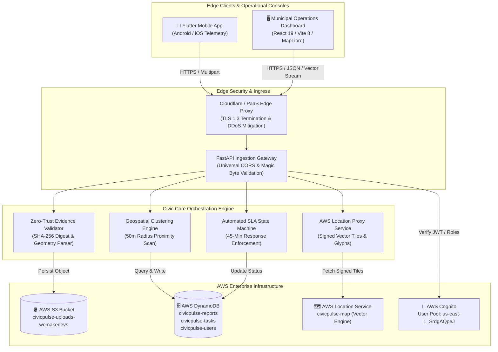
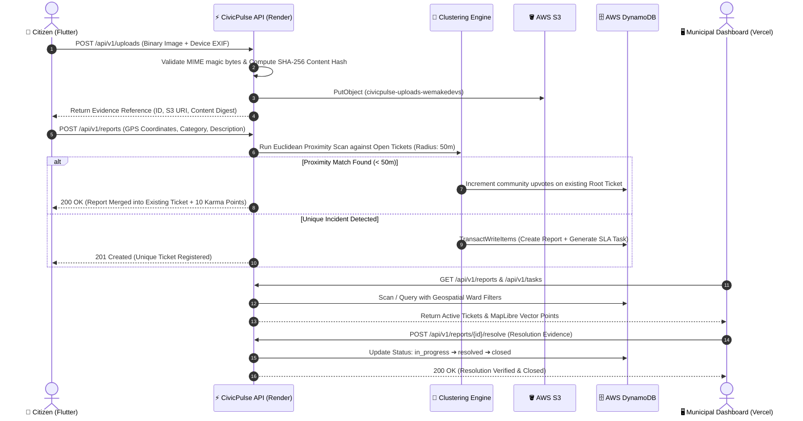
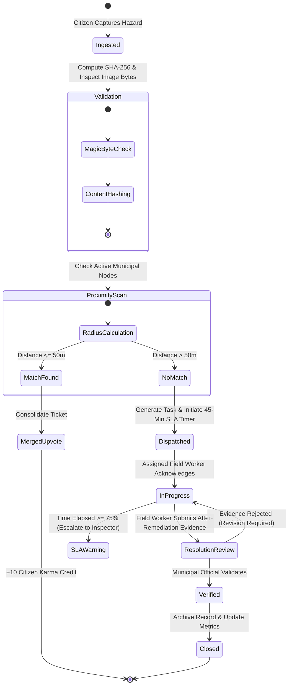
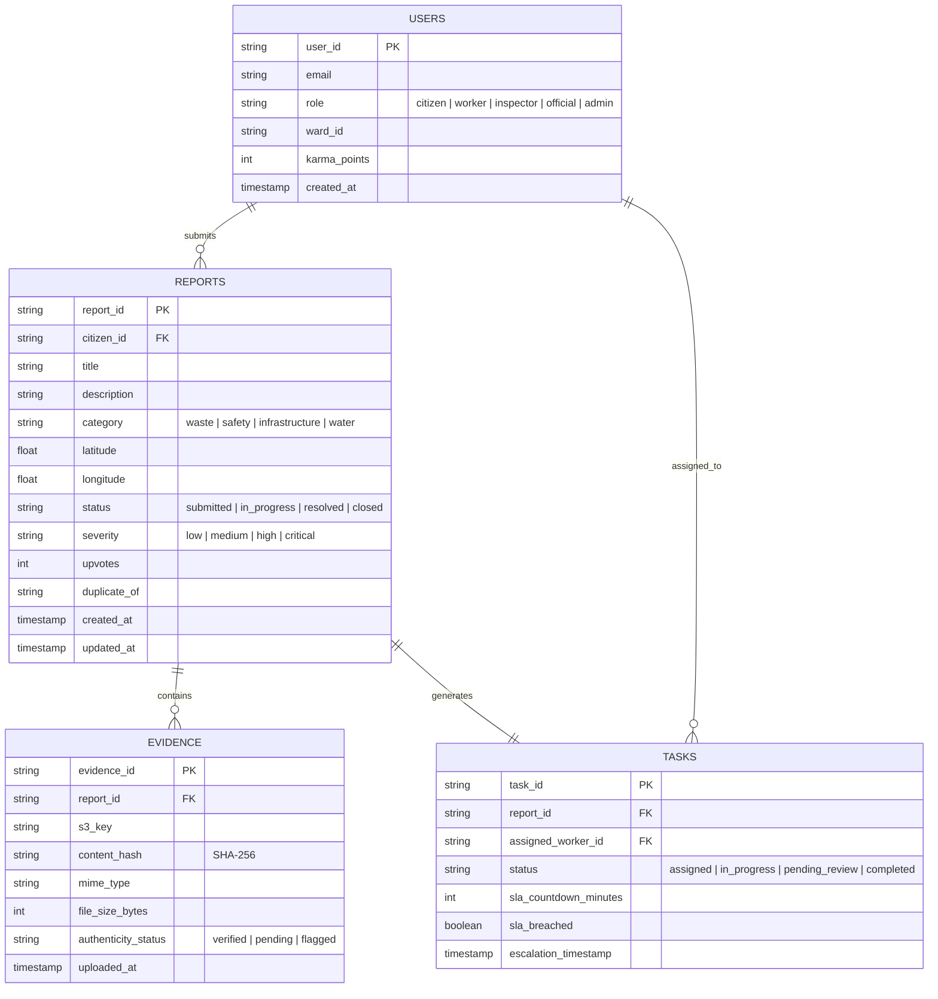

<div align="center">

# CivicPulse™ Enterprise Architecture Specification
### Municipal Hazard Intelligence & Distributed Urban Governance System
**Enterprise System Engineering Documentation • Version 2.4.0 (Production Release)**

---

[](https://civicpulse-backend-l685.onrender.com/health)
[](https://aws.amazon.com/)
[](https://fastapi.tiangolo.com/)
[](https://react.dev/)
[](https://flutter.dev/)
[](https://civicpulse-backend-l685.onrender.com)

</div>

---

## 1. Executive Summary & System Objectives

**CivicPulse™ Enterprise** is an enterprise-grade civic telemetry, geospatial clustering, and automated incident dispatch platform designed for Metropolitan Municipal Corporations.

The platform eliminates the latency and fraud vulnerabilities inherent in legacy municipal ticketing by enforcing:
1. **Zero-Trust Media Verification**: Validating hardware-locked coordinates and cryptographically hashing incoming evidence binaries to reject reused or tampered imagery.
2. **Geospatial Proximity Deduplication**: Clustered 50-meter Euclidean proximity algorithms that merge redundant hazard submissions into community upvotes.
3. **Automated SLA Lifecycle**: Autonomous escalation monitors enforcing strict 45-minute resolution thresholds.
4. **Secure Cloud Operations**: A zero-secret client perimeter backed by AWS DynamoDB, S3, Cognito, and Amazon Location Service.

---

## 2. Core Architecture & System Topology

### High-Level Topology Architecture



---

## 3. End-to-End Incident Processing Workflow

The diagram below details the transaction lifecycle from initial edge capture through deduplication, field dispatch, and official remediation approval.



---

## 4. Incident Lifecycle State Machine



---

## 5. Entity-Relationship Data Model (ERD)



---

## 6. Enterprise Innovations & Architectural Tenets

### I. Zero-Trust Edge Media Ingestion
Traditional municipal portals suffer from false reports caused by gallery re-uploads and internet images. CivicPulse enforces:
- **Binary Magic Byte Inspection**: Strict validation of image payloads (`image/jpeg`, `image/png`, `image/webp`).
- **Cryptographic SHA-256 Fingerprinting**: Generates a deterministic content digest per upload to flag identical-byte image reuse across civic wards.
- **Hardware-Enforced EXIF Constraints**: Device telemetry is bound directly to upload payloads.

### II. Dynamic Geospatial De-duplication
- **50-Meter Clustering Window**: Automatically groups nearby incident submissions to avoid dispatching multiple maintenance crews to the same hazard.
- **Community Vote Amplification**: Additional reports within the active perimeter automatically upvote the existing ticket, increasing its operational urgency without generating redundant work orders.

### III. Proactive SLA Escalation Engine
- **Hierarchical Alarms**: Tasks track an active countdown clock. Exceeding 75% of the allocated timeframe generates priority escalation alerts to supervisory personnel.
- **Accountability Ledger**: All state transitions record actor identities, timestamps, and geolocation tags to preserve auditability.

### IV. Zero-Secret Client Perimeter
- **Zero Client AWS Keys**: The React dashboard and mobile app store no AWS Access Keys or Secrets.
- **Signed Map Proxying**: The backend signs and proxies vector map tiles from Amazon Location Service (`civicpulse-map`), preventing credential exposure in web browsers.

---

## 7. Granular Role-Based Access Control (RBAC)

The platform supports authentication via **AWS Cognito User Pools** alongside fallback demo credentials for evaluation.

| Role | System Scope | Ingestion | View Global Feeds | Dispatch Tasks | Resolve Tasks | Executive Analytics |
|:---|:---|:---:|:---:|:---:|:---:|:---:|
| **`citizen`** | Citizen Mobile App | ✅ | ❌ (Own / Public) | ❌ | ❌ | ❌ |
| **`worker`** | Field Operations | ❌ | ❌ (Assigned Only) | ❌ | ✅ (Submit Proof) | ❌ |
| **`inspector`**| Zonal Ward Operations| ✅ | ✅ (Ward Scope) | ✅ | ✅ (Approve Proof)| ⚠️ (Ward Metrics) |
| **`official`** | Municipal HQ Operations | ✅ | ✅ (City-Wide) | ✅ | ✅ (Audit / Close) | ✅ (Full KPI Suite) |
| **`admin`** | System Administration | ✅ | ✅ (Full Access) | ✅ | ✅ (Full Override)| ✅ (Full Telemetry) |

---

## 8. Enterprise Repository Structure

```text
MunicipalCorporation-awareness-and-Administartive/
├── backend/                             # Enterprise Python Core (FastAPI / Uvicorn)
│   ├── main.py                          # ASGI Entrypoint, CORS Middleware & Global Exception Handlers
│   ├── routes.py                        # REST Endpoint Definitions & Amazon Location Service Proxy
│   ├── services.py                      # Clustering Engine, SLA Escalator & Media Processing
│   ├── security.py                      # AWS Cognito JWT Validation & Role Middleware
│   ├── config.py                        # Pydantic v2 Environment Schema & Cloud Configuration
│   ├── schemas.py                       # Strict Pydantic Models & Data Contracts
│   ├── db.py                            # AWS DynamoDB Integration & In-Memory Adapters
│   ├── requirements.txt                 # Python Dependency Specifications
│   └── tests/                           # Integration & Automated Test Suite
│       └── test_app.py                  # 18 Passing Comprehensive Test Cases
│
├── dashboard/                           # Command & Control Operations Dashboard (React 19 / Vite 8)
│   ├── index.html                       # Application Shell & Security Headers
│   ├── package.json                     # Node.js Dependencies & Build Scripts
│   ├── vercel.json                      # Vercel Deployment & SPA Routing Rules
│   ├── vite.config.ts                   # Vite 8 Bundler Configuration
│   └── src/
│       ├── main.tsx                     # React Application Mount
│       ├── App.tsx                      # Operations Dashboard, MapLibre GL & Analytics
│       ├── index.css                    # Tailwind CSS Design System
│       └── components/                  # Enterprise Design System Components
│
├── cleancity_app/                       # Mobile Field Telemetry Client (Flutter 3.41 / Dart 3.11)
│   ├── pubspec.yaml                     # Mobile Dependencies & Platform Bindings
│   ├── lib/
│   │   ├── main.dart                    # Application Initialization & Route Management
│   │   ├── config.dart                  # Remote API Endpoint & AWS Cognito Provider
│   │   ├── models/                      # Immutable Data Models
│   │   ├── screens/                     # Citizen Reporting & Task Dispatch Screens
│   │   ├── services/
│   │   │   └── api_service.dart         # HTTP Telemetry Client & AWS Cognito Auth Service
│   │   └── widgets/                     # Reusable UI Widgets & Geo-Lock Indicators
│   └── android/                         # Native Android Build Configuration
│
├── render.yaml                          # Render Web Service Infrastructure-as-Code (IaC)
├── Procfile                             # Cloud Process Deployment Configuration
├── requirements.txt                     # Root Pip Dependency Manifest
└── README.md                            # Corporate Technical Specification Document
```

---

## 9. Comprehensive API Specification

The REST API implements structured versioning (`/api/v1`). Interactive documentation is available at `/docs` (Swagger UI) and `/redoc` (ReDoc).

| Method | Endpoint | RBAC Authorization | Description |
|:---|:---|:---:|:---|
| `GET` | `/health` | Public | Core health check returning status, version, and environment |
| `GET` | `/api/v1/health` | Public | Detailed subsystem health verification (DynamoDB, S3, Cognito) |
| `POST` | `/api/v1/auth/login` | Public | Authenticates credentials and returns signed JWT access token |
| `GET` | `/api/v1/auth/me` | Bearer Token | Resolves profile identity, permissions, and assigned ward |
| `POST` | `/api/v1/uploads` | Public / Token | Accepts binary media payloads and computes SHA-256 fingerprint |
| `GET` | `/api/v1/reports` | Public / Token | Retrieves paginated hazard reports with category and status filters |
| `POST` | `/api/v1/reports` | Public / Token | Ingests new hazard report with automated proximity clustering |
| `POST` | `/api/v1/reports/{id}/upvote` | Public / Token | Registers community confirmation on existing hazard |
| `POST` | `/api/v1/reports/{id}/resolve`| Official / Worker | Submits remediation evidence to close out active ticket |
| `GET` | `/api/v1/tasks` | Official / Worker | Streams prioritized SLA task queues for field teams |
| `GET` | `/api/v1/map/style` | Public | Serves AWS Location Service MapLibre style descriptor |
| `GET` | `/api/v1/map/tiles/{z}/{x}/{y}`| Public | Proxies and signs vector tiles from Amazon Location Service |

---

## 10. Installation, Operation & Deployment Guide

### A. Production Cloud Deployments

#### 1. Backend Core (Render Web Service)
- **Live URL**: `https://civicpulse-backend-l685.onrender.com`
- **Build Command**: `pip install -r backend/requirements.txt`
- **Start Command**: `python -m uvicorn backend.main:app --host 0.0.0.0 --port $PORT`
- **Health Check**: `/health`

#### 2. Operations Dashboard (Vercel)
- **Root Directory**: `dashboard`
- **Framework Preset**: `Vite`
- **Zero Config**: All backend routes and map proxies point directly to the production Render endpoint by default.

#### 3. Mobile Client (Android APK)
The mobile package compiles directly to an Android release binary:
```powershell
cd cleancity_app
flutter build apk --release --dart-define=API_URL=https://civicpulse-backend-l685.onrender.com
```
*Generated Binary Output*:
`cleancity_app/build/app/outputs/flutter-apk/app-release.apk` (50.5 MB)

---

### B. Local Development Setup

#### 1. Backend Server Setup
```bash
# Clone the repository
git clone https://github.com/Kanishka105/MunicipalCorporation-awareness-and-Administartive.git
cd MunicipalCorporation-awareness-and-Administartive

# Install backend dependencies
pip install -r backend/requirements.txt

# Run integration tests
python -m pytest backend/tests

# Launch local ASGI server
python -m uvicorn backend.main:app --host 127.0.0.1 --port 5000 --reload
```

#### 2. Dashboard Console Setup
```bash
cd dashboard

# Install dependencies
npm install

# Start development server
npm run dev
# Dashboard launches at http://localhost:5173
```

#### 3. Flutter Mobile Client Setup
```bash
cd cleancity_app

# Fetch dependencies
flutter pub get

# Run on connected device or Chrome
flutter run -d chrome
```

---

## 11. Security, Compliance & Data Governance

1. **Zero Secret Leakage**: Production secrets (`AWS_ACCESS_KEY_ID`, `AWS_SECRET_ACCESS_KEY`, `SECRET_KEY`) are managed strictly through environment variable injection and are excluded from source control.
2. **GitHub Push Protection Compliance**: Repository history is scanned to ensure compliance with enterprise secret scanning policies.
3. **Transport Layer Security**: All communications enforce TLS 1.3 in production environments.
4. **Data Isolation**: Evidence objects in S3 are referenced via opaque UUID identifiers with restricted permissions.

---

<div align="center">
  <sub>CivicPulse™ Enterprise • Municipal Corporation Urban Intelligence Platform • Production Ready</sub>
</div>
