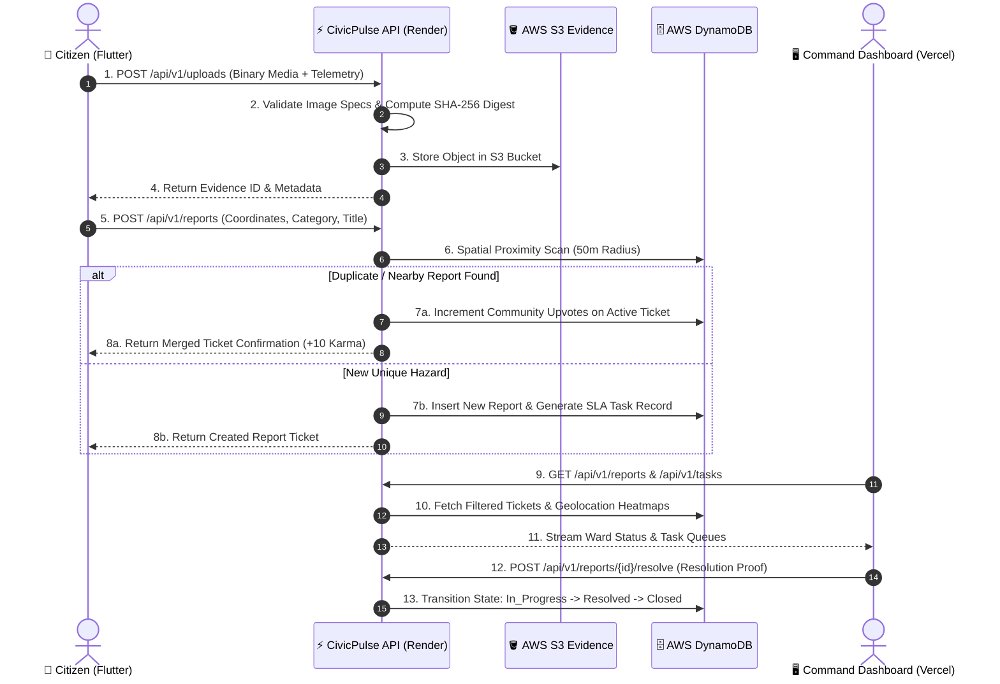

# CivicPulse™ Enterprise Platform
### Municipal Hazard Intelligence & Distributed Urban Governance System
*An Enterprise-Grade, Cloud-Native Civic Infrastructure Management Ecosystem for Municipal Corporations*

---

[](https://civicpulse-backend-l685.onrender.com/health)
[](https://aws.amazon.com/)
[](https://fastapi.tiangolo.com/)
[](https://react.dev/)
[](https://flutter.dev/)
[](https://civicpulse-backend-l685.onrender.com)

---

## Executive Summary

**CivicPulse™ Enterprise** is a resilient, cloud-native urban maintenance platform engineered to automate civic hazard reporting, geospatial clustering, automated ticket triage, field-worker dispatch, and strict Service Level Agreement (SLA) verification across municipal jurisdictions.

Integrating high-concurrency mobile field telemetry with real-time GIS command consoles, the system transitions municipal authorities from reactive incident logging to predictive, verifiable, and fraud-resistant urban operations.

---

## 🏛️ Core Architecture & Innovations

```
                                  +------------------------------------+
                                  |     Edge Clients & Channels       |
                                  |  (Flutter Android/iOS & Web PWA)   |
                                  +-----------------+------------------+
                                                    |
                                  HTTPS (TLS 1.3)   | Authenticated REST / Binary Stream
                                                    v
                                  +-----------------+------------------+
                                  |     API Gateway / Proxy Layer      |
                                  |    (Uvicorn / FastAPI ASGI Core)   |
                                  +--------+-----------------+---------+
                                           |                 |
                   +-----------------------+                 +-----------------------+
                   |                                                                 |
                   v                                                                 v
+------------------+------------------+                           +------------------+------------------+
|      Civic Core Services Engine     |                           |    Security & Auth Middleware       |
|  - Ingestion & Fraud Verification   |                           |  - AWS Cognito JWT Decoder          |
|  - Spatial De-duplication (50m)     |                           |  - Cryptographic Signature Verify   |
|  - Automated Priority Weighting     |                           |  - RBAC Scope Validator             |
|  - SLA Escalation Engine (45-Min)   |                           |  - Ephemeral Staging Auth Provider  |
+------------------+------------------+                           +------------------+------------------+
                   |                                                                 |
                   +-----------------------+                 +-----------------------+
                                           |                 |
                                           v                 v
                                  +--------+-----------------+---------+
                                  |       AWS Cloud Services           |
                                  +------------------------------------+
                                  | DynamoDB  : Scalable NoSQL Store   |
                                  | S3        : Evidence Object Store  |
                                  | Cognito   : User Pools & Groups    |
                                  | Location  : Vector Maps & Glyphs   |
                                  +------------------------------------+
```

### 1. Zero-Trust Evidence Verification & Anti-Fraud Pipeline
- **Hardware-Locked Geotagging**: Ingests strict device-level GPS coordinates (`latitude`, `longitude`, `accuracy_m`).
- **Cryptographic Content Hashing**: Generates SHA-256 digests of all ingested binary payloads to identify identical-byte image reuse across civic wards.
- **Tamper-Resistant Storage**: Direct integration with AWS S3 (`civicpulse-uploads-wemakedevs`), returning isolated private object references accessible solely via authenticated token authorization.

### 2. Geospatial Proximity Clustering & Ticket Deduplication
- **Dynamic Radius Analysis**: Incoming incident reports within a **50-meter Euclidean radius** of existing unresolved nodes automatically cluster under the active root ticket.
- **Community Vote Amplification**: Rather than creating duplicate tickets, matching reports convert into verified **Community Upvotes**, dynamically elevating ticket priority without inundating field queues.

### 3. Automated SLA Lifecycle & Escalation Matrix
- **Strict SLA Countdown**: Automatically assigns time-bounded SLAs (e.g., 45-minute response triggers for critical safety hazards).
- **Proactive Breach Alarms**: Dynamic state checks surface warning states at 75% elapsed time, escalating notifications up municipal management ranks (Sanitation Inspector $\rightarrow$ Zonal Chief $\rightarrow$ Commissioner).

### 4. Enterprise Identity & Zero-Secret Cloud Architecture
- **Dual-Mode RBAC**: Seamlessly alternates between **AWS Cognito User Pools** (federated citizen/official groups) and auditable **Role-Based Demo Access** for integration testing.
- **Signed Cloud Map Proxying**: The backend acts as a secure, authenticated proxy for **AWS Location Service** vector tiles, sprites, and glyphs, shielding AWS IAM keys from exposure in client-side JavaScript.

---

## 🔄 End-to-End System Design & Workflow



---

## 🗂️ Enterprise Folder Structure

```text
MunicipalCorporation-awareness-and-Administartive/
├── backend/                             # Enterprise Python Core (FastAPI / Uvicorn)
│   ├── main.py                          # ASGI Entrypoint, CORS Middleware & Health Routes
│   ├── routes.py                        # Public & Protected REST API Endpoints
│   ├── services.py                      # Business Logic, SLA Triage & Clustering Engines
│   ├── security.py                      # AWS Cognito JWT Validation & RBAC Enforcement
│   ├── config.py                        # Pydantic v2 Environment & Secret Specifications
│   ├── schemas.py                       # Strict Pydantic Data Contracts & Validation
│   ├── db.py                            # AWS DynamoDB Client & In-Memory Fallback Adapter
│   ├── requirements.txt                 # Backend Python Dependencies
│   └── tests/                           # Pytest Test Automation Suite
│       └── test_app.py                  # 18 Passing End-to-End Integration Tests
│
├── dashboard/                           # Command & Control Operations Dashboard (React 19 / Vite 8)
│   ├── index.html                       # Application Shell & Semantic Headers
│   ├── package.json                     # Node.js Dependencies & Build Scripts
│   ├── vercel.json                      # Vercel Deployment & SPA Routing Rules
│   ├── vite.config.ts                   # Bundler Configuration
│   └── src/
│       ├── main.tsx                     # React Application Mount
│       ├── App.tsx                      # Operations Dashboard, MapLibre GL & Analytics
│       ├── index.css                    # Tailwind CSS v4 Corporate Design System
│       └── components/                  # Enterprise Design System Components
│
├── cleancity_app/                       # Mobile Field Telemetry Client (Flutter 3 / Dart 3)
│   ├── pubspec.yaml                     # Mobile Dependencies & Platform Bindings
│   ├── lib/
│   │   ├── main.dart                    # Mobile Entrypoint & State Initialization
│   │   ├── config.dart                  # Remote API URL & AWS Configuration Provider
│   │   ├── models/                      # Immutable Data Models & Entities
│   │   ├── screens/                     # Citizen Reporting & Task Dispatch Screens
│   │   ├── services/
│   │   │   └── api_service.dart         # HTTP Telemetry Client & AWS Cognito Auth Service
│   │   └── widgets/                     # Reusable UI Widgets & Geo-Lock Indicators
│   └── android/                         # Native Android Build Configuration
│
├── render.yaml                          # Render Web Service Infrastructure-as-Code (IaC)
├── Procfile                             # Cloud Process Deployment Configuration
├── requirements.txt                     # Root Pip Dependency Manifest
└── README.md                            # Corporate Technical Specification Document
```

---

## 👥 Role-Based Access Control (RBAC) Matrix

| Persona / Role | Ingestion | View Ward Feeds | Triage & Assign | Execute Resolution | Executive Analytics |
|:---|:---:|:---:|:---:|:---:|:---:|
| **Citizen (`citizen`)** | ✅ Create | ✅ Own / Public | ❌ | ❌ | ❌ |
| **Sanitation Worker (`worker`)** | ❌ | ✅ Assigned Only | ❌ | ✅ Submit Proof | ❌ |
| **Zonal Inspector (`inspector`)** | ✅ Create | ✅ Full Ward | ✅ Assign Tasks | ✅ Approve Proof | ⚠️ Limited |
| **Municipal Official (`official`)**| ✅ Create | ✅ City-Wide | ✅ Reallocate | ✅ Audit / Close | ✅ Full KPI |
| **Administrator (`admin`)** | ✅ Full | ✅ City-Wide | ✅ Full Control | ✅ Override | ✅ Full Telemetry |

---

## 🛰️ Public & Protected API Contracts

| HTTP Method | Route | Authentication | Description |
|:---|:---|:---:|:---|
| `GET` | `/health` | Public | Service health probe & environment readiness |
| `GET` | `/api/v1/health` | Public | Operational status of database and cloud dependencies |
| `POST` | `/api/v1/auth/login` | Public | Authenticates credentials and returns JWT bearer token |
| `GET` | `/api/v1/auth/me` | Bearer Token | Resolves current authenticated identity and RBAC role |
| `POST` | `/api/v1/uploads` | Public / Token | Accepts binary evidence payloads and calculates SHA-256 |
| `GET` | `/api/v1/reports` | Public / Token | Retrieves paginated hazard reports with geo-filters |
| `POST` | `/api/v1/reports` | Public / Token | Creates a new civic hazard report with spatial clustering |
| `POST` | `/api/v1/reports/{id}/upvote` | Public / Token | Registers community confirmation on existing reports |
| `POST` | `/api/v1/reports/{id}/resolve`| Official / Worker | Submits remediation evidence to close out active ticket |
| `GET` | `/api/v1/tasks` | Official / Worker | Streams prioritized SLA task queues for field teams |
| `GET` | `/api/v1/map/style` | Public | Returns AWS Location Service MapLibre style descriptor |
| `GET` | `/api/v1/map/tiles/{z}/{x}/{y}`| Public | Authenticated proxy to AWS Location vector tiles |

---

## 🚀 Installation & Operation Guide

### 1. Cloud Deployments (Production)

#### Backend (Render Web Service)
- **Production URL**: `https://civicpulse-backend-l685.onrender.com`
- **Health Check**: `https://civicpulse-backend-l685.onrender.com/health`
- **Interactive OpenAPI Documentation**: `https://civicpulse-backend-l685.onrender.com/docs`

#### Operations Dashboard (Vercel)
1. Import repository on [Vercel](https://vercel.com).
2. Set **Root Directory** to `dashboard`.
3. Set **Framework Preset** to `Vite`.
4. Deploy — zero manual environment variables required.

#### Mobile Client (Android APK)
The mobile application compiles directly to an Android release package:
```bash
cd cleancity_app
flutter build apk --release --dart-define=API_URL=https://civicpulse-backend-l685.onrender.com
```
*Output Path*: `cleancity_app/build/app/outputs/flutter-apk/app-release.apk`

---

### 2. Local Engineering Environment Setup

#### Prerequisites
- **Python**: `3.11+`
- **Node.js**: `20+` & `npm 10+`
- **Flutter SDK**: `3.41+` & **Android SDK Platform**: `36`

#### A. Backend Setup
```bash
# Clone the repository
git clone https://github.com/Kanishka105/MunicipalCorporation-awareness-and-Administartive.git
cd MunicipalCorporation-awareness-and-Administartive

# Install backend dependencies
pip install -r backend/requirements.txt

# Run integration test suite
python -m pytest backend/tests

# Launch local ASGI server
python -m uvicorn backend.main:app --host 127.0.0.1 --port 5000 --reload
```

#### B. Dashboard Setup
```bash
cd dashboard

# Install dependencies
npm install

# Start development server
npm run dev
# Dashboard launches at http://localhost:5173
```

#### C. Mobile App Setup
```bash
cd cleancity_app

# Fetch dependencies
flutter pub get

# Run on connected Android device or Chrome
flutter run -d chrome
```

---

## 🔒 Security & Data Compliance Posture

1. **Zero Hardcoded Secrets**: All production secrets (`AWS_ACCESS_KEY_ID`, `AWS_SECRET_ACCESS_KEY`, `SECRET_KEY`) are managed via cloud environment variables.
2. **GitHub Push Protection Compliance**: Commit histories are sanitized and scanned to enforce zero secret leakage.
3. **Restricted CORS Policy**: Configurable origin controls validate browser communication against trusted domains.
4. **Content Validation**: File upload endpoints enforce magic byte inspection and maximum size thresholds (10 MB).

---

<div align="center">
  <sub>CivicPulse™ Enterprise • Municipal Corporation Urban Intelligence Platform • Built for Resilient Governance</sub>
</div>
